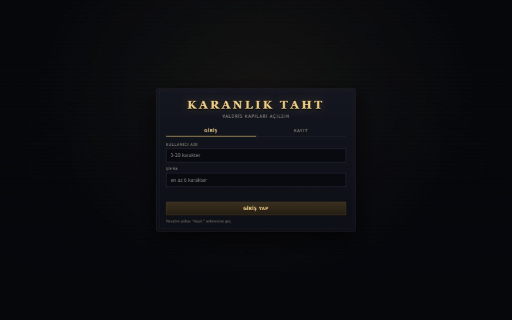
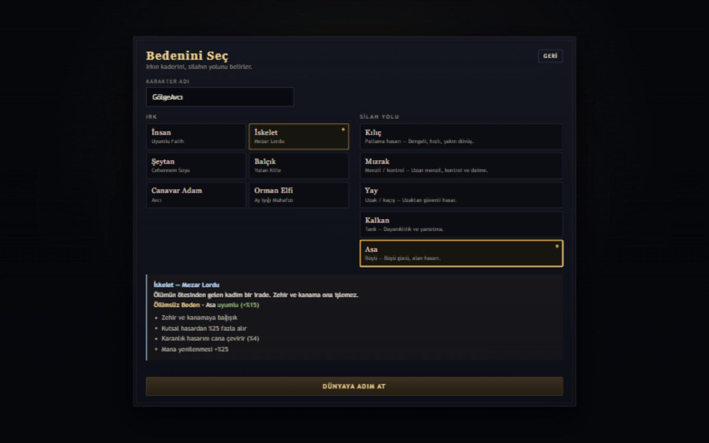
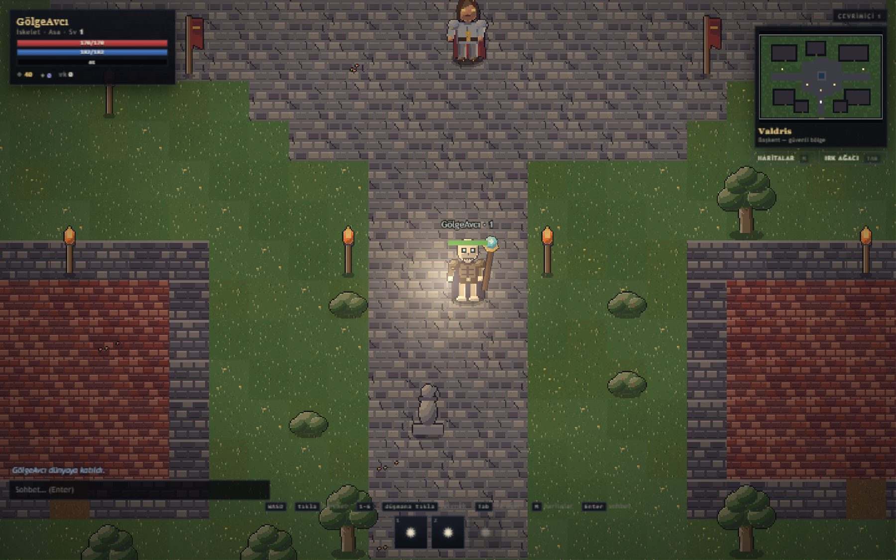
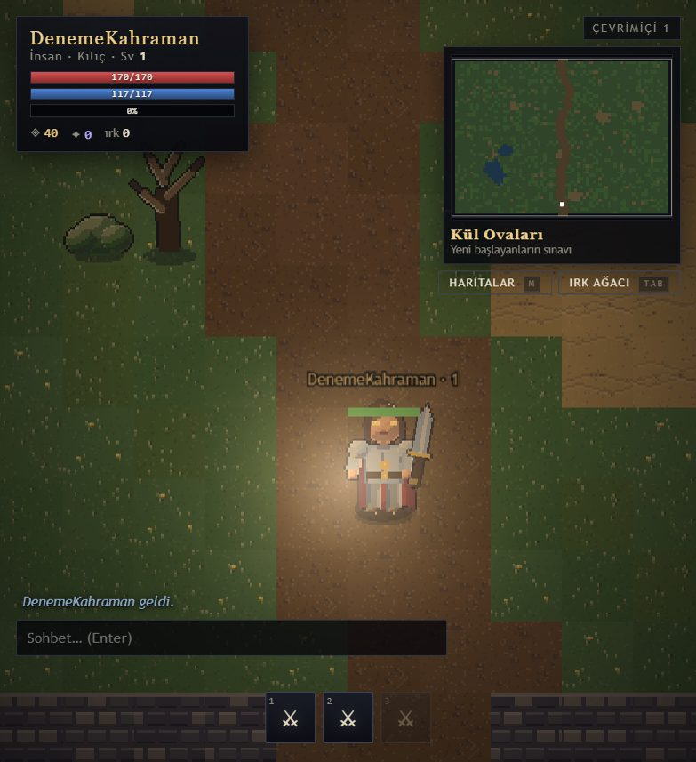
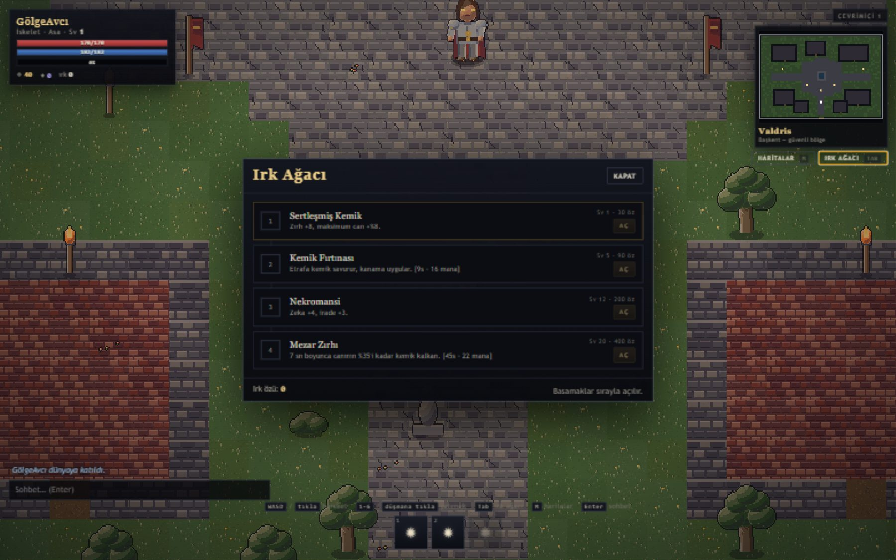

# Karanlık Taht

[Oyunu aç: taht.mehmetacar.org](https://taht.mehmetacar.org)

Karanlık Taht, tarayıcı tabanlı çok oyunculu RPG projesidir. Bu depo kaynak kodu değil; tanıtım metni, sürüm notları ve ekran görüntülerini içerir.

## Ekran görüntüleri

| Giriş | Karakter yaratma |
| --- | --- |
|  |  |

| Valdris | Kül Ovaları |
| --- | --- |
|  |  |

## Bu depo ne içerir?

- Oyuna giden bağlantı ve proje tanıtımı
- v1.0.0 sürüm notları (`CHANGELOG.md`)
- Oyundan alınmış görseller (`docs/ekran/`)

## Ne yapmaz?

Bu depo oyun sunucusunu, istemci kaynak kodunu veya kurulabilir bir paket içermez. Oynanış, sunucu güvenliği, kayıtların kalıcılığı ve hizmetin erişilebilirliği bu depodaki dosyalardan bağımsız olarak doğrulanamaz; tanıtım metnindeki bu tür ifadeleri bağımsız teknik doğrulama olarak değerlendirmeyin.

## Sürüm

Depodaki sürüm notları v1.0.0'ı 28 Ekim 2026 tarihli ilk genel sürüm olarak belirtir. [Sürüm notları](CHANGELOG.md).

---

Mehmet Acar tarafından geliştirildi.