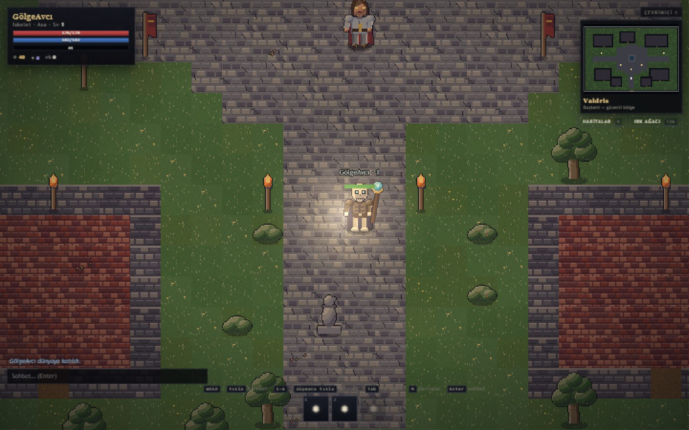
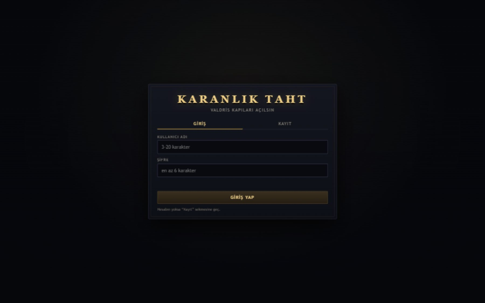
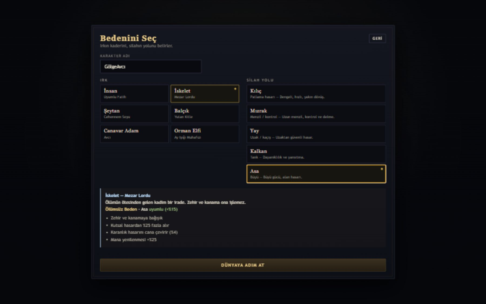
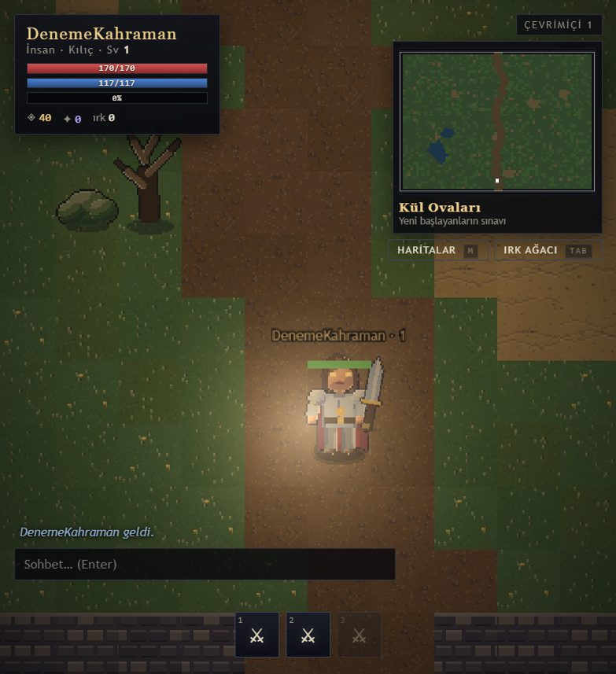
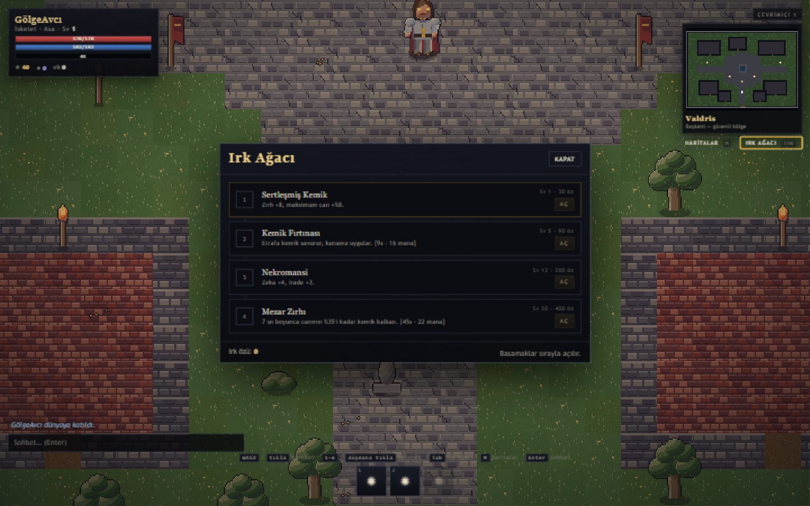

# Karanlık Taht

**Tarayıcıda çalışan, gerçek zamanlı çok oyunculu pixel-art RPG.**

Sunucu otoriteli dövüş, kalıcı karakterler, altı ırk ve beş silah yolu. Kurulum yok,
indirme yok — tarayıcıyı aç, karakterini yarat, dünyaya çık.

  
  
  
  

### ▶ [taht.mehmetacar.org](https://taht.mehmetacar.org)

---

## Bu nedir?

Karanlık Taht, tek bir tarayıcı sekmesinde oynanan küçük ama tam teşekküllü bir çevrimiçi
RPG. Bir masaüstü istemcisi, bir launcher ya da bir hesap sistemi kurmak yok: siteyi açıyorsun,
ırkını ve silahını seçiyorsun, karakterin sunucuda kalıcı olarak duruyor.

Amacım klasik bir "tıkla ve bekle" tarayıcı oyunu değil, gerçek bir aksiyon hissi vermekti:
vuruşlar anlık, konumlar sunucuda hesaplanıyor, düşmanlar seni fark edip peşine düşüyor,
başka oyuncularla aynı haritada aynı anda dolaşıyorsun.

Oyun **v1.0.0** sürümünde ve canlı olarak oynanabilir durumda.

## Neler var?

- **Gerçek zamanlı sunucu otoriteli dövüş** — hasar, menzil, kaçınma ve ölüm sunucuda
  hesaplanır; istemci yalnızca gösterir.
- **Kalıcı karakter** — seviye, statlar, altın, ırk özü ve açtığın ağaç düğümleri veritabanında
  saklanır; sekmeyi kapatıp geri döndüğünde kaldığın yerden devam edersin.
- **6 ırk, her biri farklı oynanır** — pasifleri, başlangıç statları ve silah yatkınlıkları
  birbirinden ayrı.
- **5 silah yolu** — her biri kendi üç yeteneğiyle gelir; yetenekler tuşlarla anlık kullanılır.
- **Irk ağacı** — düşmanlardan düşen **ırk özü** ile dört basamaklı ağacı sırayla açarsın;
  son basamaklar gerçek bir güç sıçraması.
- **5 bölge** — güvenli başkentten başlayıp giderek sertleşen av alanları.
- **Canlı sohbet ve PvP** — güvenli bölge dışında oyuncular birbirine saldırabilir.
- **Element ve statü etkileri** — ateş, zehir, karanlık, kutsal; kanama, zehir, yavaşlatma,
  sersemletme, kalkan ve aşınma.
- **Pixel-art dünya** — sanatın tamamı sıfır bağımlılıkla üretilen bir üreteçle hazırlandı:
  döşemeler, bitkiler, alevler, moblar ve arayüz simgeleri.

## Nasıl oynanır?

1. **[taht.mehmetacar.org](https://taht.mehmetacar.org)** adresini aç.
2. Bir kullanıcı adı ve parola ile kayıt ol (e-posta gerekmez).
3. **Karakter yarat**: ırkını ve silahını seç. Bu seçim oynayışını baştan sona belirler —
   seçtiğin silah üç yeteneğini, ırkın ise pasifini ve ağacını verir.
4. Karakterine tıkla ve **Valdris**'te doğ. Burası güvenli başkent: burada kimse sana
   saldıramaz, NPC'lerle konuşabilir, haritalar panelinden çıkabilirsin.
5. **M** ile haritaları aç, **Kül Ovaları**'na git ve ilk düşmanlarını avla.
6. Düşen **ırk özü** ile **Tab** panelinden ırk ağacını aç, seviye atladıkça yeni bölgelere ilerle.

### Kontroller

| Tuş | İşlev |
| --- | --- |
| `W A S D` / yön tuşları | Yürü |
| Sol tık | Yürü ya da hedefe saldır |
| `1` – `6` | Yetenekler (`İnsan` ırkında 7. slot da açılır) |
| `Tab` | Irk ağacı |
| `M` | Haritalar |
| `E` | Yakındaki NPC ile konuş |
| `N` | Sesi aç / kapat |
| `Enter` | Sohbet |
| `Esc` | Paneli kapat |

## Dünyalar

| Bölge | Seviye | Hava |
| --- | --- | --- |
| **Valdris** | — | Başkent, güvenli bölge. PvP kapalı, NPC'ler burada |
| **Kül Ovaları** | 1 – 8 | Yeni başlayanların sınavı; iskeletler, kurtlar, haydutlar |
| **Kararmış Orman** | 8 – 18 | Ağaçların fısıldadığı yer; örümcekler, treantlar, gölgeler |
| **Kırık Tapınak** | 18 – 28 | Kültistlerin yuvası; muhafızlar ve ateş büyücüleri |
| **Cehennem Yarığı** | 28 – 40 | Ateşin ve kemiklerin diyarı — ve **Kemik Ejderha** |

Yarık'ın sonunda 9000 canlı bir boss var; tek başına girmek cesaret ister.

## Irklar

| Irk | Unvan | Pasif | Karakter |
| --- | --- | --- | --- |
| **İnsan** | Uyumlu Fatih | Uyum | +%10 deneyim, **+1 yetenek slotu**, dengeli statlar |
| **İskelet** | Mezar Lordu | Ölümsüz Beden | Zehir/kanama bağışıklığı, karanlığı cana çevirir, +%25 mana |
| **Şeytan** | Cehennem Soyu | Cehennem Kanı | %40 ateş direnci, canı yarıdan azken +%15 hasar |
| **Balçık** | Yutan Kitle | Esnek Kütle | Fiziksel hasar −%20, en yüksek can, zırh eriten asit |
| **Canavar Adam** | Avcı | Avcı İçgüdüsü | +%15 hareket, +%10 saldırı hızı, minimapta canavarlar |
| **Orman Elfi** | Ay Işığı Muhafızı | Ormanın Armağanı | +%20 mana, +%5 kaçınma, en güçlü yay/asa yatkınlığı |

Her ırkın ağacı dört basamak: iki stat/direnç düğümü ve iki gerçek yetenek. Örneğin İskelet
*Kemik Fırtınası* ile etrafına kanama saçar, Şeytan *Kanat Atılışı* ile ileri atılıp yakar,
Balçık *Yutma* ile hedefini içine çekip kökler.

## Silah yolları

| Silah | Tarz | Yetenekler |
| --- | --- | --- |
| **Kılıç** | Dengeli yakın dövüş | Vuruş · Yarma · İnfaz |
| **Mızrak** | Menzil ve kontrol | Saplama · Süpürme · Delme |
| **Yay** | Uzaktan güvenli hasar | Ok · Ok Yağmuru · Delen Ok |
| **Kalkan** | Tank ve yansıtma | Kalkan Vuruşu · Siper · Yansıtma |
| **Asa** | Büyü ve alan hasarı | Cıvata · Nova · Meteor |

Irk–silah uyumu gerçek bir fark yaratır: Orman Elfi + Yay en yüksek yatkınlıkla başlar,
Balçık + Kalkan ise neredeyse kırılmaz bir duvara dönüşür.

## Ekran görüntüleri

| Giriş | Karakter yaratma |
| --- | --- |
|  |  |

| Valdris (başkent) | Kül Ovaları |
| --- | --- |
|  |  |

## Teknik olarak

Tek bir Node.js süreci hem oyunu (HTTP + WebSocket) hem de derlenmiş istemciyi servis eder;
ayrı bir web sunucusu, veritabanı sunucusu veya CDN gerekmez. Veri tek bir SQLite dosyasında
tutulur. İstemci PixiJS ile çizilir, arayüz saf HTML/CSS'tir ve tüm dünya/ırk/yetenek
tanımları sunucu ile istemcinin paylaştığı tek bir kaynaktan gelir — böylece ikisi asla
birbirinden ayrışmaz.

Oyun HTTPS üzerinden, tek bir komutla ayağa kalkacak şekilde paketlendi; sunucu yeniden
başladığında açık oyuncular kaydedilerek kapatılır, veritabanı her gün otomatik yedeklenir.

> Bu depoda **kaynak kod bulunmaz**. Burada yalnızca oyunun tanıtımı, sürüm notları ve
> ekran görüntüleri yer alır. Oynamak için yukarıdaki bağlantı yeterlidir.

## Sürüm

| Sürüm | Tarih | Not |
| --- | --- | --- |
| **v1.0.0** | 2026-10-28 | İlk genel sürüm: 6 ırk, 5 silah, 5 bölge, canlı PvP, ırk ağacı, kalıcı karakter |

Ayrıntılar: [CHANGELOG.md](CHANGELOG.md)

## Sık sorulanlar

**Ücretsiz mi?** Evet. Reklam yok, ödeme yok, indirme yok.

**Mobilde oynanır mı?** Oyun masaüstü ve dizüstü için tasarlandı; klavye ve fareyle
en iyi deneyimi verir.

**Hesabımı kaybeder miyim?** Karakterler veritabanında kalıcıdır ve günlük yedek alınır.
Yine de parolanı kimseyle paylaşma.

**Kaç kişiyle oynanır?** Tek sunucu üzerinde herkes aynı dünyada; sohbet ve PvP canlı.

**Hile koruması var mı?** Dövüş, hareket ve ödüller sunucuda hesaplandığı için istemci
tarafında değiştirilen değerler oyunu etkilemez.

---

  <a href="https://taht.mehmetacar.org">taht.mehmetacar.org</a> ·
  Mehmet Acar tarafından geliştirildi · 2026

